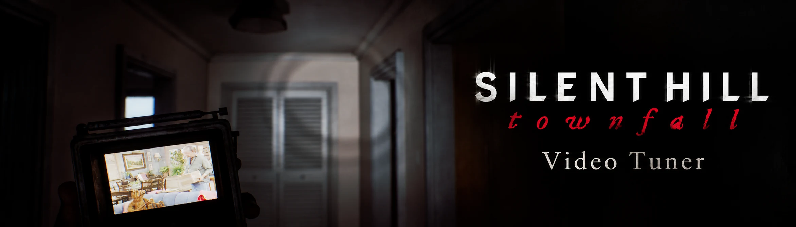
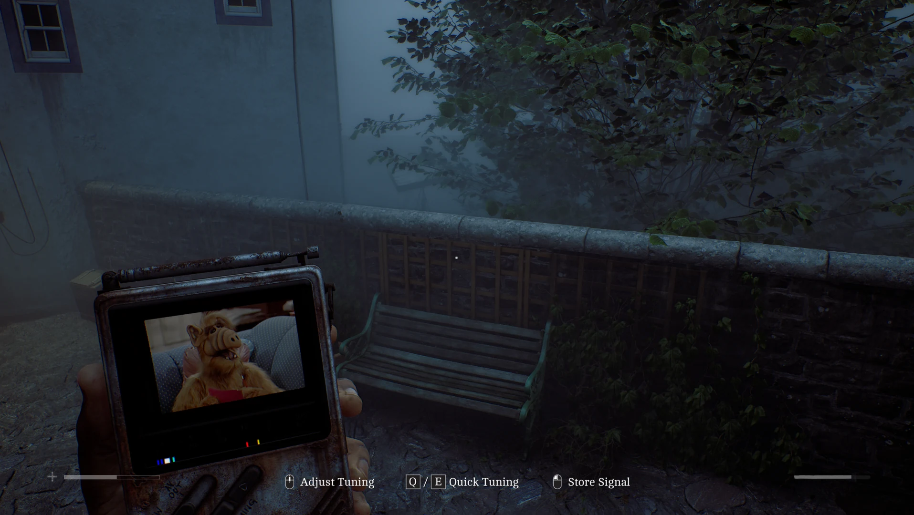

# Townfall Video Tuner – a Silent Hill Townfall mod



*In Townfall, sometimes all you can do is hide in the dark and wait for the danger to pass. But who says you have to
wait in silence? Tune into your favourite show on the CRTV, escape the horrors outside for a little while, and find
some comfort in something familiar. Just don’t get too comfortable.*

**Townfall Video Tuner is a SILENT HILL: Townfall mod that turns your own videos into stations on the CRTV.** Put MP4
or MKV files in the `Videos` folder, raise the CRTV and tune to a magenta mark on the dial (it sometimes takes a
moment to load).

- Every video gets its own frequency, marked in magenta on the CRTV's tuning scale.
- The video always continues where you left off (until you quit the game).
- This mod also works with [Townfall Companion](https://www.nexusmods.com/silenthilltownfall/mods/125).

The mod is also available on **[Nexus Mods](https://www.nexusmods.com/games/silenthilltownfall/mods/145)**.

[](https://youtu.be/SJfDdsagm8E)



## Requirements

- **SILENT HILL: Townfall** on Steam, Windows. Tested on Steam build 25697972.
- **[UE4SS for SILENT HILL Townfall](https://www.nexusmods.com/silenthilltownfall/mods/4)** by AeonGreyh. The UE4SS
  releases on GitHub crash this game; this package has the fix.

## Installation

1. Install [UE4SS for SILENT HILL Townfall](https://www.nexusmods.com/silenthilltownfall/mods/4) into
   `Townfall\Binaries\Win64`.
2. Download the latest release from
   [Releases](https://github.com/smaugikun/silent-hill-townfall-video-tuner/releases/latest). Open
   `Townfall\Binaries\Win64\ue4ss\Mods` and copy the **`TownfallVideoTuner`** folder from that download into it.
3. Put your videos directly in `Mods\TownfallVideoTuner\Videos` (not in folders inside it).
4. Start the game and load your save. Raise the CRTV and tune to a magenta mark. *`Videos\stations-auto.ini` lists
   the frequency each video got.*

**Updating:** close the game and copy the new `TownfallVideoTuner` folder over the old one. If you changed
`stations.ini`, keep your copy.

**Uninstalling:** delete `...\ue4ss\Mods\TownfallVideoTuner`.

## Your videos

A few things before you set up your lineup.

> **Fewer and smaller videos work best.** The CRTV's screen shows 640×480, so a 480p or 720p video looks the same.
> Larger videos can make the game stutter. One, two or three videos are plenty.

- **MP4 and MKV files only.** Picture: H.264 or H.265. Sound: AAC.
- Videos with **Dolby sound** (AC-3, E-AC-3: often "DD5.1", "DDP5.1" or "EAC3" in the file name), **DTS or TrueHD
  play without sound**: the game's player can't read them. Convert their audio to AAC first, or find a different
  version. For an MKV file, `tf-video.log` says `No sound from Videos/...`.
- Restart the game after adding or removing videos.

## Settings

[`TownfallVideoTuner\stations.ini`](TownfallVideoTuner/stations.ini) is optional, and its comments explain each
setting: where the stations go, stations of your own at fixed frequencies, loop, volume and the sound's fade. Restart
the game after changing it.

Automatic stations use the dial's ends (0.010 to 0.200 and 0.800 to 0.990) and keep their frequencies while they
stay clear of the game's signals. A station of your own keeps its frequency; where it overlaps a game signal, the
game's signal plays there. Monsters, waypoints, transmissions, fine tuning and cutscenes take over as usual, and the
mod never moves your dial or raises the CRTV for you.

## Troubleshooting

- **No magenta marks:** load your save first; the marks come once the level's signals are known. Check
  `Videos\stations-auto.ini` and `tf-video.log`.
- **A video plays without sound:** see [Your videos](#your-videos).
- **A video doesn't play:** check its picture format (H.264 or H.265), then `tf-video.log`.
- **The game stutters:** use fewer and smaller videos (480p or 720p).

The mod's log is `TownfallVideoTuner\tf-video.log`; `ue4ss\UE4SS.log` has a few lines of it too, starting with
`[TF-VIDEO]`. More: [Troubleshooting](docs/TROUBLESHOOTING.md).

## Good to know

**The mod can affect the game's performance.** Playing a video takes the game extra work: decoding it, drawing it on
the CRTV and mixing its sound. Larger videos take more; if the game stutters, use fewer and smaller videos.

The mod changes no game files and comes with no videos; you need to use your own videos. I used AI for major parts of
the mod. If you're against using AI, this mod might not be for you.

## Building from source

The release zip comes ready to use. To build it yourself (Windows, Python 3.11 or newer):

```
py -m pip install -r requirements-dev.txt
py build.py --game-root "C:\Program Files (x86)\Steam\steamapps\common\Townfall"
py test.py --game-root "C:\Program Files (x86)\Steam\steamapps\common\Townfall"
py tools/package.py
```

`build.py` compiles `tf_video.dll` from `native/` with Zig; with `--game-root` it also writes the installed game's
profile, which the release ships, the way the DLL does after a game update. `test.py` runs the native, Lua, profile
and installer tests (`--game-root` adds the checks against the installed game, its symbol file and its FMOD).
`tools/package.py` builds `dist/TownfallVideoTuner-<version>.zip`.
`tools/install.py --game-root <folder> --update --install` installs into a game, keeping its videos and settings.
How it works: [docs/ARCHITECTURE.md](docs/ARCHITECTURE.md).

## Credits

Townfall Video Tuner by smaugikun, open source under the [MIT License](LICENSE.txt). UE4SS by the UE4SS-RE Team and
contributors ([RE-UE4SS](https://github.com/UE4SS-RE/RE-UE4SS)); its Townfall package and signature by Aeon Greyh.
More in [Third-party notices](THIRD_PARTY_NOTICES.md).

SILENT HILL is a trademark of KONAMI. This is an unofficial fan mod, not affiliated with or endorsed by KONAMI or the
developers or publishers of SILENT HILL: Townfall.
